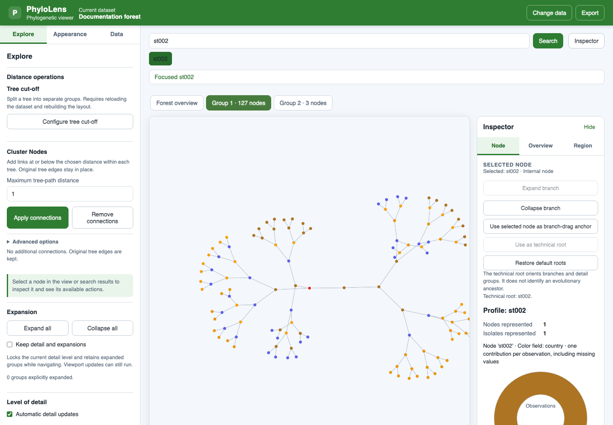

# Technical roots

A technical root orients each tree component for subtree navigation and levels
of detail. Selecting a different existing node changes that orientation. It does
not infer an evolutionary ancestor or change the underlying tree.

## Change the root

Select an ordinary node in the view or search results. In **Selected node**, choose
**Use as technical root**. Expand a LoD group before choosing a node within it.
The operation changes only that node's component root. The inspector lists the
current technical roots.



**Restore default roots** restores the roots recorded by the original preparation
for all components. Newick defaults come from its serialization. Typing defaults
use the configured goeBURST LV ranking. A new input load establishes new defaults.

The separate **branch-drag anchor** controls how branches move during dragging.
It does not change technical rooting or rebuild LoD.

### PHYLOViZ comparison

The desktop PHYLOViZ goeBURST viewer's **Set as founder** control is related but
has different edge semantics. In the `phyloviz-main` source, the
[Founder action](https://github.com/phyloviz/phyloviz-main/blob/master/net-phyloviz-gtview/src/net/phyloviz/gtview/ui/GraphView.java#L1043)
calls
[`updateVisibleEdges(root)`](https://github.com/phyloviz/phyloviz-main/blob/master/net-phyloviz-goeburst/src/net/phyloviz/goeburst/cluster/GOeBurstClusterWithStats.java#L175).
That method temporarily raises the selected profile's LV ranks and repeats
Kruskal edge selection. The displayed spanning-tree edges can change.

PhyloLens technical rerooting preserves every existing edge and changes only
rooted orientation and derived artifacts. It implements the topology-preserving
requirement; it does not establish parity with PHYLOViZ founder selection.

## What changes

Rooted depths, parent links and subtree intervals are rebuilt. LoD groups,
representatives and their summaries are prepared again, and a new immutable
layout version is published. Component IDs currently identify technical roots;
the response supplies an old-to-new component mapping. The browser preserves the
active component and camera, refreshes its tabs, and discards saved panel states
that contain old subtree or cluster identities.

Manual folds, explicit expansion state and additional distance connections are
cleared when adopting a changed orientation. Their controls can be applied again.
Automatic relaxation stops, and dragging returns to individual nodes. Existing
node arrangements remain available because canonical node identities and base
coordinates are retained.

The underlying nodes, tree edges, branch lengths, original isolate observations,
metadata and component membership are preserved. Global coordinates are reused.
PhyloLib inference and Graphviz layout are not rerun. Original prepared versions
remain readable. Small components protected from automatic grouping may look the
same after rerooting, although their parent links and branch-fold behavior change.

## Browser API

```ts
import { toNodeId } from '@phyloviz/phylo-lens';

if (view.canSetTechnicalRoot()) {
  await view.setTechnicalRoot(toNodeId('selected-node'));
  console.log(view.getTechnicalRoots());
  await view.setTechnicalRoot(null); // Restore all default roots.
}
```

The promise resolves after the new rooted viewport has been adopted. Concurrent
metadata and root changes are serialized per loaded view. A new load or disposal
supersedes pending results. Failed replacement reads retain the previous view.

## Service and persistence

`POST /api/graph/root` accepts an explicit source layout version and a canonical
node ID, or null to restore defaults. See the [HTTP reference](API_REFERENCE.md).
The operation reads a saved normalized preparation snapshot and publishes the
rebuilt artifacts in one database transaction. Equivalent concurrent requests
converge on one immutable version. SQLite uses an immediate transaction;
PostgreSQL holds a shared source-row lock, and deletion locks that row before
removing its artifacts.

The `preparation_sources` table stores a normalized dataset snapshot, preparation
options and default roots. This adds O(N + E + M) storage per prepared revision
for N nodes, E edges and M metadata/isolate values. The explicit snapshot keeps
rerooting independent of original uploads and inference executables, including
after a restart. Metadata revisions update the snapshot in their own transaction.
Submitting the original upload with a root override would reuse the preparation
endpoint but repeat inference and global layout. The saved-source revision keeps
coordinate identity and avoids requiring the original upload again.

Rerooting takes O(N + E) time for the rooted index, plus the existing LoD
materialization and summary costs: O(T(N + E)) traversal/member work across T
tiers, with the implementation's member and cluster sorting costs in addition.
It reuses coordinates but recomputes group bounds and representatives; it is not
constant-time. The current implementation rebuilds the forest's LoD tiers even
when only one component's root changes.

SQLite creates the additive table on initialization. PostgreSQL deployments must
run `phylo-lens-init-postgres` for schema v5 before starting updated API replicas
and workers. Layouts prepared before snapshots were stored must be loaded again
to enable rerooting; the service returns an explanatory error for those versions.
