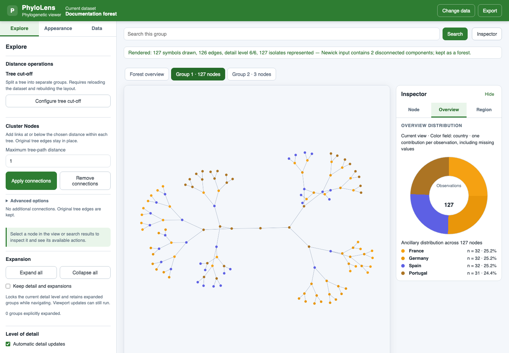

PhyloLens documentation

# Explore trees. Keep the detail that matters.

PhyloLens is an embeddable viewer for fully labelled trees,
minimum spanning trees, and their forest components. Explore large structures
through levels of detail, then inspect the original nodes and their observations.

  <a class="manual-card" href="getting-started/"><strong>Start exploring</strong>Load a tree or typing profiles, attach observations, and navigate the view.</a>
  <a class="manual-card" href="walkthrough/"><strong>Follow the visual guide</strong>See detail groups, forest tabs, technical roots, and publication exports.</a>
  <a class="manual-card" href="INTEGRATION/"><strong>Build with PhyloLens</strong>Embed the browser library, use the server directly, or supply your own adapter.</a>

## From input to an interactive view

Import a Newick tree or infer a tree from an MLST/cgMLST-style profile matrix.
Typing inference supports **goeBURST Full MST** and **standard goeBURST with a
chosen maximum nLV level**. Attach ancillary observations to inspect categories,
counts, and individual isolate identities.

Zoom to move between detail levels. Expand or fold branches, search for a node,
and choose a technical root to orient the detail groups. Distance cutoffs prepare
separate tree components; additional distance connections are a display overlay.

## Two components, independent integration

The npm browser library and HTTP API service can be deployed separately. Use the
default pairing, implement another frontend against the server API, or connect
the viewer to your own data source through a public `GraphClient`.

Read [integration choices](INTEGRATION.md), the [browser API](../code/client/README.md),
or the [server setup guide](../code/server/README.md).

## Scientific scope

Technical roots orient branches and detail groups. They do not identify an
evolutionary ancestor. Original isolate observations remain distinct from both
biological profile groups and visual LoD representatives.

See the [algorithm references](ALGORITHM_REFERENCES.md) for published foundations
and the [data model](DATA_MODEL.md) for these distinctions.
