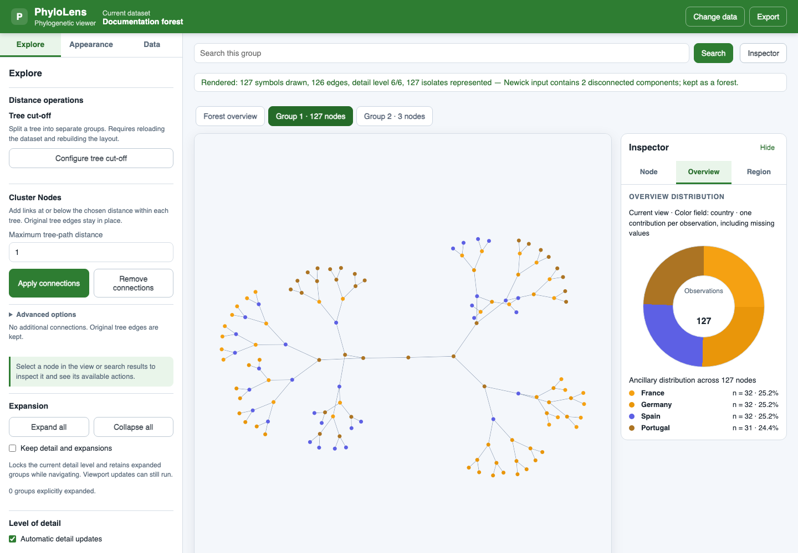
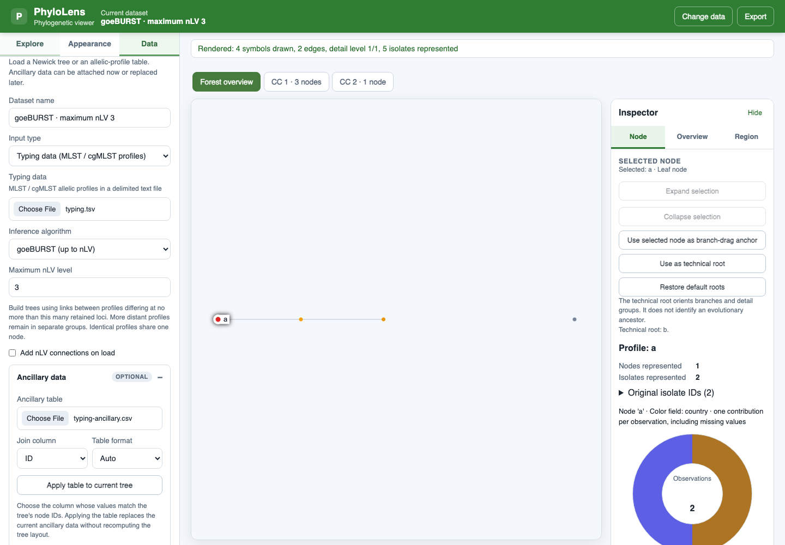
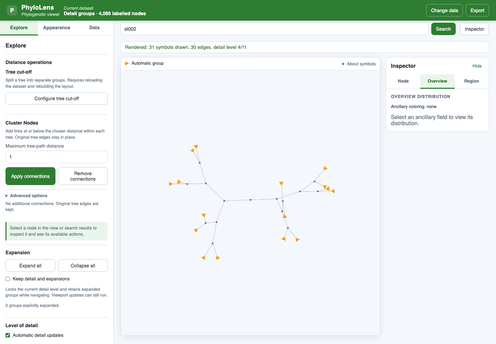
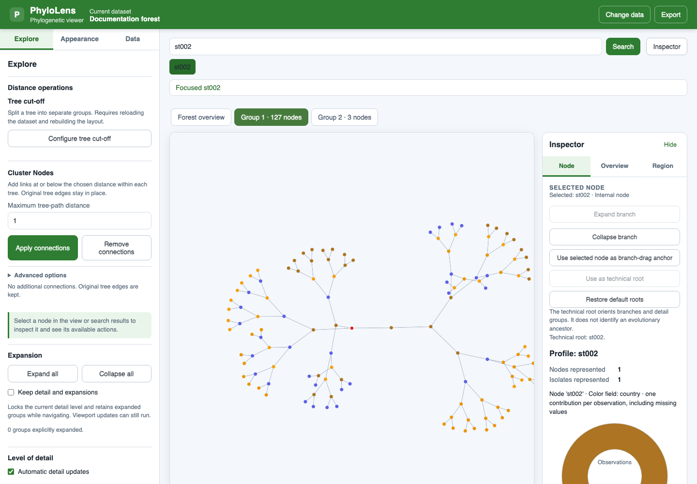
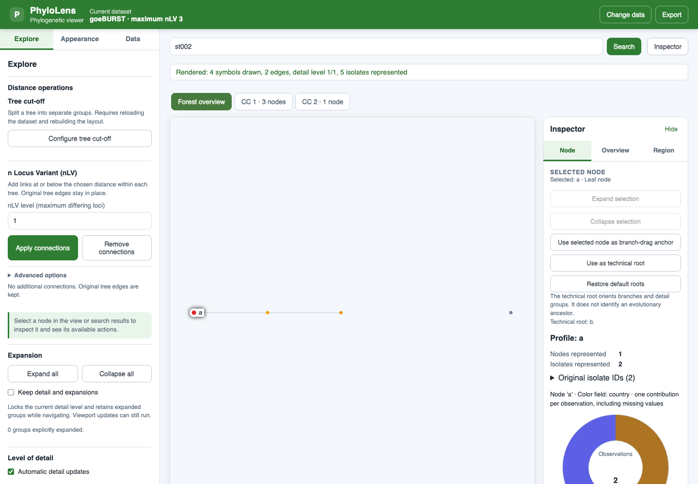
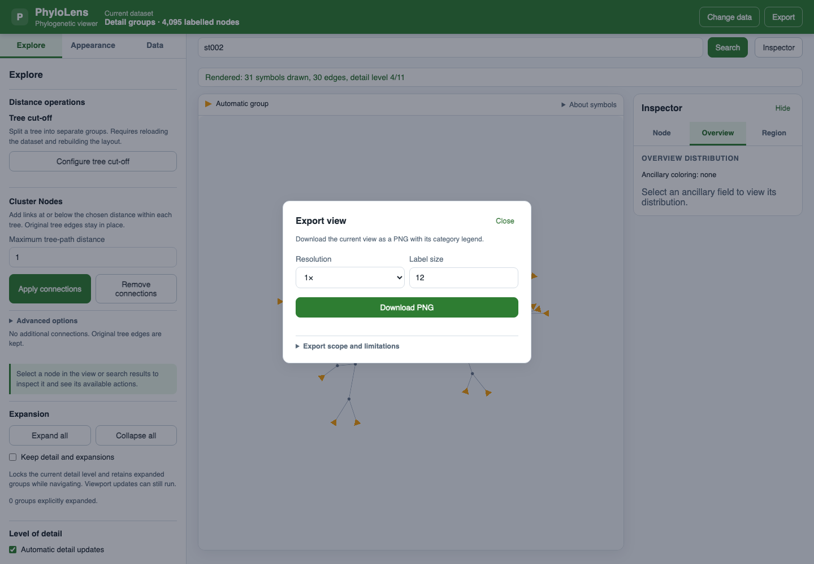

# A visual walkthrough

These screenshots come from the running application and synthetic, fully
labelled [documentation examples](../examples/documentation/README.md).
They show real service preparation and viewer interactions.

## 1. Load a tree and attach observations

Use the **Data** panel to choose the input file and an ancillary CSV/TSV table.
After preparation, the view is ready for pan, zoom, search and selection. In
**Appearance**, choose a field to color nodes or their pie distributions.

The synthetic country values illustrate the visual mapping. They are not a
biological inference or an epidemiological result.

For typing input, choose Full MST or standard goeBURST and its maximum nLV level
before applying the data:

## 2. Explore detail groups

Large trees use rooted detail groups. Zoom in to inspect finer representations.
Triangles identify grouped structure; their represented-node counts have a
different meaning from isolate frequencies on a typing profile.

Use **Expand selected branch or group**, **Expand all**, and **Collapse all** to
control detail explicitly. See [expansion and folding](EXPAND_COLLAPSE.md) for
partial results, manual folds and observation summaries.

## 3. Choose a technical root

Select an ordinary node and choose **Use as technical root**. The inspector shows
the current roots. This reorients branches and rebuilds the detail groups while
retaining the original tree and coordinates.

**Restore default roots** returns to the original orientation. Read
[technical roots](REROOTING.md) for how this affects saved branch and panel state.

## 4. Work with separate components

Forest tabs show individual connected components alongside the overview. Newick
uses Group labels. Typing data uses local CC labels for connected profile groups;
these numbers are not reference-database assignments.

Standard goeBURST includes links up to the selected nLV level. Its inference
setting is separate from the additional nLV connection overlay available after
preparation. See [distance operations](DISTANCE_OPERATIONS.md).

## 5. Export the visible result

Open **Export view**, choose a resolution and label size, and download the PNG.
The export can include the legend and explanations of aggregate symbols.

The image contains the current camera and visible detail. Expand the relevant
groups first when you want original nodes shown in the figure.
